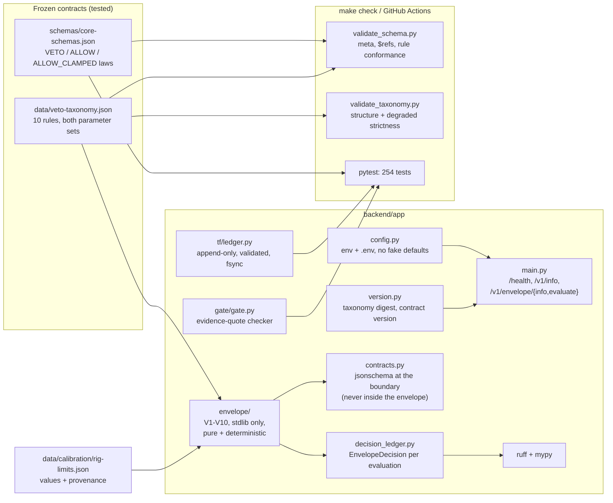
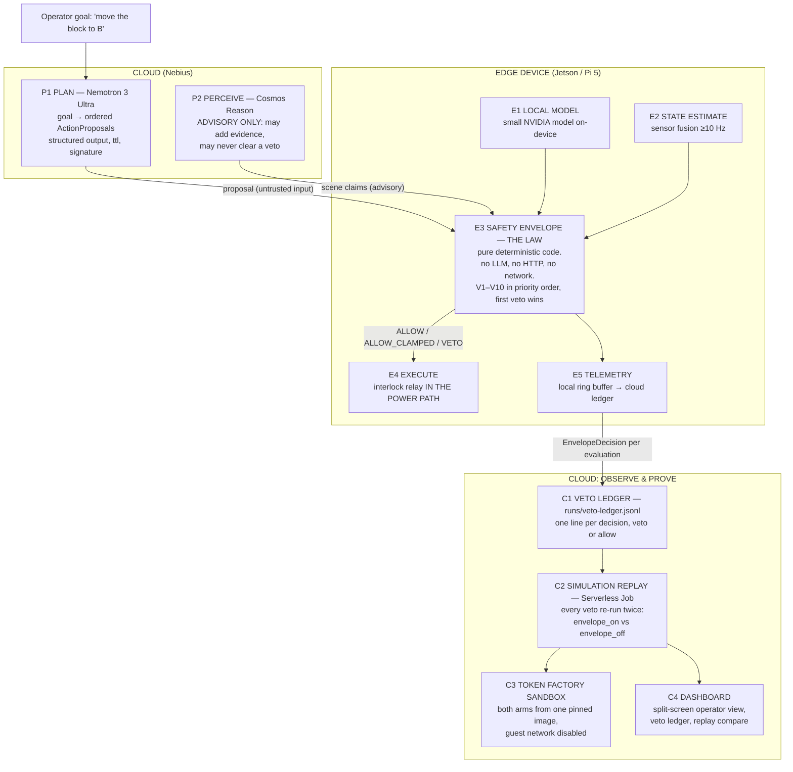

# Architecture — Reflex

Two diagrams, deliberately separate: **what exists today** and **what the target is**. Confusing the two is
the failure mode this file exists to prevent.

---

## 1. What exists today (Phase 2)

### The envelope's three boundaries

| Boundary | Who validates | Why there and not inside |
|---|---|---|
| Untrusted input (`SensorSnapshot`, `ActionProposal`) | `app/contracts.py` (jsonschema) | jsonschema's dependency chain can reach `urllib`; the purity test forbids it inside `app.envelope` |
| Values | `app/envelope/params.py` (loader refuses to start) | A limit that fails to load must stop the process, not default to something plausible |
| Output (`EnvelopeDecision`) | `app/contracts.py`, before it reaches the ledger | A ledger of unvalidated decisions is not an audit trail |

Inside those boundaries the envelope is a pure function of `(ruleset, snapshot, proposal,
requested_mode)`: no clock, no I/O, no randomness, no mutable module state. `determinism_hash`
covers `{envelope_version, proposal, snapshot}` minus `ts_mono_ms`; `decision_id` is that hash
truncated, so identical inputs deduplicate instead of double-logging.

The gate is an **evidence-quote checker**: it answers "does this sentence appear verbatim in that
document?" It is not a safety envelope, it does not read the taxonomy, and its verdict vocabulary
(`PASS`/`FAIL`/`UNDETERMINED`) does not match the contract's `Outcome`
(`ALLOW`/`ALLOW_CLAMPED`/`VETO`). Three tests in `backend/tests/test_gate.py` are marked
`xfail(strict=True)` to record that gap; they will start failing when it is fixed, which is the point.

---

## 2. Target architecture (Phase 2–4)

### The envelope's rules (frozen in `data/veto-taxonomy.json`)

| Rule | Severity | Fires when |
|---|---|---|
| **V1** EMERGENCY_STOP | hard_stop | e-stop asserted, or the interlock relay is open |
| **V2** KEEP_OUT_OCCUPIED | hard_stop | an object or person is inside the marked keep-out volume |
| **V3** VELOCITY_LIMIT | clamp | commanded speed exceeds the limit for the current mode |
| **V4** FORCE_LIMIT | hard_stop | measured/estimated force exceeds the limit |
| **V5** WORKSPACE_BOUND | clamp | commanded pose lies outside the allowed volume |
| **V6** COLLISION_PREDICTED | hard_stop | the swept volume intersects an object |
| **V7** SENSOR_STALE | hard_stop | a required sensor's data is older than its window |
| **V8** NETWORK_DEGRADED | degrade | the cloud is unreachable beyond the window → switch to stricter parameters, never fail open |
| **V9** PLAN_MALFORMED | reject | the proposal fails schema, preconditions, TTL, or requests a limit above the ceiling |
| **V10** HUMAN_PRESENCE | hard_stop | a hand or person is in the cell |

Each rule carries two parameter sets. **Degraded mode is strictly more conservative** — that invariant is
machine-checked by `scripts/validate_taxonomy.py`, not asserted in prose.

### The two artifacts

| Artifact | Content | Writer |
|---|---|---|
| `runs/ledger.jsonl` | one line per model call: tokens, cached tokens, cost, latency, status | `backend/app/tf/ledger.py` (**exists**) |
| `runs/veto-ledger.jsonl` | one `EnvelopeDecision` per evaluation: intended action, shipped action, full rule trace, sensor snapshot, hashes | Phase B |

They are separate on purpose. Cost telemetry and safety evidence have different retention, different
readers and different failure modes.

---

## 3. Non-negotiable properties

1. **No network in the decision path.** The envelope package must not import an LLM client, an HTTP client
   or a socket. Enforced by an import-graph test.
2. **Determinism.** Same `(sensor snapshot, proposal, envelope_version)` → same `determinism_hash`, in a
   separate process. Wall clock is never an input.
3. **No fail-open.** Missing sensor, stale sensor, malformed plan, lost network → stop or degrade.
4. **A model cannot clear a veto.** Cosmos Reason's output may add evidence; it may never widen the
   envelope.
5. **The interlock is physical.** A relay in the actuator's power path, with a bypass test proving motion
   is impossible when it is open. A software flag is not an interlock.
6. **The record is complete.** Every evaluation is written, including the ones that allowed motion.
