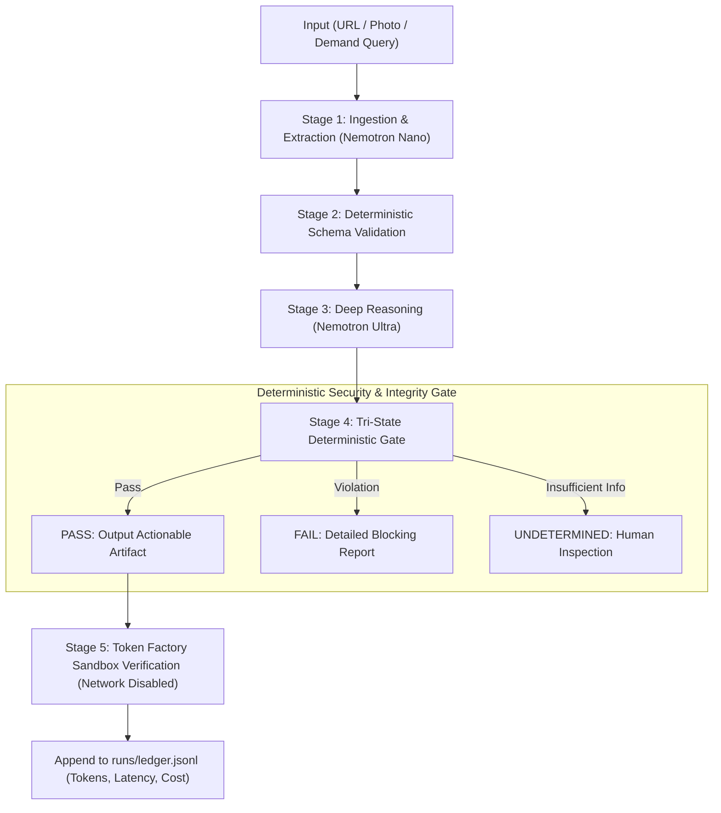

# Architecture & Dataflow — Reflex — Deterministic Edge Safety Envelope & Cloud Replay for Physical AI

---

## Key Subsystems

1. **Deterministic Gate (`backend/app/gate/`):**
   - Pure Python / zero-LLM decision logic.
   - Evaluates outputs strictly against frozen rule tables (`data/`).
   - If statutory citations, geometric metrics, or coordinates cannot be anchored to raw input spans, the output is dropped.

2. **Isolated Sandbox Verification (`backend/app/sandbox/`):**
   - Generated compliance reports and artifacts are compiled and hash-verified inside Nebius Token Factory Sandboxes.
   - Guest networking is disabled to mathematically guarantee no external data leakage.

3. **Instrumentation & Telemetry Ledger (`backend/app/tf/ledger.py`):**
   - Records granular token metrics (prompt, completion, cached token hits), latency, model ID, and estimated dollar costs per stage.
   - Computes counterfactual cost comparisons against single-model baselines.
